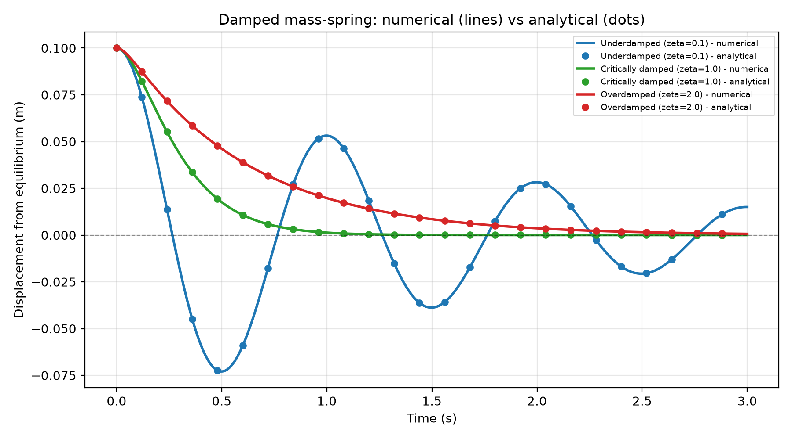

# Mechanical Engineering Portfolio

**Fardad Khondakar · Undergraduate Mechanical Engineering student**

Engineering computations grounded in physical models, dimensional consistency, and reproducible validation. I use **Python and MATLAB** and study **Calculus, Thermodynamics, Fluid Mechanics, CAD/FEA, and Materials Science**.

This repository starts with a working vibration study. Other subject areas describe my coursework and future interests; they are not claims of completed projects.

## Featured project: free vibration of a mass–spring–damper

A single-degree-of-freedom model compares numerical integration with closed-form displacement solutions for underdamped, critically damped, and overdamped responses.

$$m\ddot{x}+c\dot{x}+kx=0$$

Here $x$ is measured from static equilibrium in metres, $m$ is mass in kilograms, $c$ is viscous damping in $\mathrm{N\,s/m}$, and $k$ is stiffness in $\mathrm{N/m}$.



The project produces displacement histories, a phase portrait, energy histories, and a damping-ratio sweep. [Read the derivation, assumptions, and interpretation](projects/mass-spring-damper/README.md).

## Quick start

Use Python 3.11 or newer. From the repository root:

```bash
python -m venv .venv
```

Activate the environment:

```powershell
# Windows PowerShell
.\.venv\Scripts\Activate.ps1
```

```bash
# macOS / Linux
source .venv/bin/activate
```

Then install, validate, and run:

```bash
python -m pip install -r requirements.txt
python -m unittest discover -s tests -v
python projects/mass-spring-damper/mass_spring_damper.py --no-show
```

Omit `--no-show` to open the plot windows. Figures are saved beside the project script regardless of the working directory. For headless environments, set `MPLBACKEND=Agg` before running. Use `--output-dir PATH` for another destination.

## Repository map

```text
projects/mass-spring-damper/   Working Python model, derivation, and four figures
 tests/                      Physics and analytical comparison checks
 docs/                       Engineering conventions, roadmap, validation report
 reference/original-uploads/ Unmodified source uploads for traceability
 .github/workflows/          Automated validation on push and pull request
```

## How I approach engineering problems

1. Define the system, coordinate direction, known quantities, and the question.
2. State idealizations and applicability limits before calculating.
3. Derive the governing equations without skipping intermediate steps.
4. Track SI units and check dimensional consistency.
5. Validate using initial conditions, analytical limits, and conservation or dissipation laws.
6. Interpret the result physically and disclose numerical limitations.

See [engineering conventions](docs/ENGINEERING_CONVENTIONS.md) and the [learning roadmap](docs/ROADMAP.md). MATLAB is a tool I use; an `ode45` implementation is a planned extension, not included here.

## Validation and reuse

[Validation report](docs/VALIDATION.md) records measured errors and test results. Solver tolerances are local error controls and do not guarantee an identical bound on global displacement error.

The original uploaded files are retained in `reference/original-uploads/`. No open-source license has been selected; choose one before inviting reuse. See [contribution guidance](CONTRIBUTING.md).
